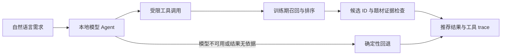

# RecAgent Lab

**用真实推荐工具驱动的本地电影推荐 Agent。** 用户用自然语言描述偏好，本地模型调度召回与排序；系统只接受训练期目录中的电影，并返回可检查的工具 trace。项目面向推荐系统与 Agent / 应用 AI 工程岗位。

> 当前可运行：MovieLens-1M 数据处理、Popularity / ItemCF 基线、固定候选评测、确定性工具流程、本地 Qwen 工具调用及失败回退。API 服务、跨查询对话评测和更复杂的推荐模型仍在计划中。

## 系统如何工作



模型选择工具与结果 ID；标题、题材和推荐理由来自训练期目录与排序结果。用户 ID 由请求固定，模型不能通过工具参数读取其他用户历史。

## 快速开始

在 Python 3.10+ 环境和仓库根目录执行：

```powershell
python -m pip install -e .
python scripts/download_data.py --dataset ml-1m
python scripts/preprocess.py --config configs/data/ml1m.yaml
```

已有 MovieLens-1M 数据时，可用 `python scripts/download_data.py --dataset ml-1m --local-source <ml-1m目录>`。原始数据和处理结果保存在 `data/`，不进入 Git。

无需模型服务即可运行基线和确定性 Agent：

```powershell
python scripts/recommend_baseline.py --processed-dir data/processed/ml1m --user-id 6040 --top-k 3
python scripts/evaluate_baseline.py --processed-dir data/processed/ml1m --k 10
python scripts/run_agent_demo.py --processed-dir data/processed/ml1m --user-id 6040 --query "想看科幻，不要恐怖" --top-k 3
```

真实模型演示需先按[本地模型指南](docs/LOCAL-LLM.md)启动 Ollama 并准备支持工具调用的模型：

```powershell
# 默认模型为 qwen2.5:1.5b；使用本机 GGUF 导入模型时，先设置：
# $env:RECAGENT_LLM_MODEL = "recagent-qwen2.5"
python scripts/run_local_llm_agent.py --processed-dir data/processed/ml1m --user-id 6040 --query "想看科幻，不要恐怖" --top-k 3
```

输出中 `fallback_used=false` 且 `tool_trace` 包含 `recall_candidates`、`rank_candidates`，表示模型完成了受校验的工具流程；`fallback_used=true` 表示运行时使用了确定性推荐结果。

## 已验证的结果

固定候选离线评测纳入 1,208 名用户，每人使用 1 个测试正样本和 100 个冻结负样本。下列指标只反映该采样候选的排序，不等同于全库召回或在线效果。

| 模型 | Recall@10 | NDCG@10 | 覆盖率 |
| --- | ---: | ---: | ---: |
| Popularity | 0.2649 | 0.1403 | 0.1040 |
| ItemCF | 0.2053 | 0.1165 | 0.1537 |

ItemCF 在此协议下覆盖更多电影，但准确率低于热度基线。协议与负样本修正见[基线报告](reports/baseline-sampled-ml1m.md)和[负样本审计](reports/eval-negative-collision-audit.md)。

本机使用 Qwen2.5-1.5B GGUF + Ollama，对同一条 MovieLens 查询连续运行 4 次，均完成召回和排序且未回退；Agent 内部延迟约 2.5–2.8 秒。这是[冒烟验证](reports/local-llm-smoke-2026-10-29.md)。进一步在[30 条冻结对话任务](reports/dialogue-ml1m-2026-10-29.md)上评测，最终结果经回退后全部满足约束，但模型在 20 条普通任务中仅直接完成 3 条。项目公开这项局限，不把回退后的 100% 最终成功率当作模型能力。

Ollama 默认 `qwen2.5:1.5b` 的正文 JSON 工具调用已加入严格兼容处理；但它在同一冻结任务集上的直接完成率为 0/20，详见[兼容报告](reports/ollama-default-compatibility-2026-10-29.md)。默认模型可用于验证单条演示，跨查询结果须看回退状态。

复现对话评测：

```powershell
python scripts/evaluate_dialogue_agent.py --mode deterministic --output reports/dialogue-deterministic-ml1m.json
$env:RECAGENT_LLM_MODEL = "recagent-qwen2.5"  # 仅使用本地 GGUF 导入模型时设置
python scripts/evaluate_dialogue_agent.py --mode llm --output reports/dialogue-llm-ml1m.json
```

## 工程边界

- 只读工具：`search_movies`、`get_user_history`、`recall_candidates`、`rank_candidates`。
- 最多 4 次工具调用、6 轮模型请求、60 秒总预算；最终电影 ID 必须来自已排序结果。
- 本地模型连接仅接受回环地址；密钥和模型原始回复不写入 trace。
- 无法由目录字段证明的约束留在 `unparsed_constraints`，不会伪称已满足。

核心代码在 [`recagent/engine/`](recagent/engine/)（推荐基线）、[`recagent/agent/`](recagent/agent/)（工具与模型循环）、[`recagent/eval/`](recagent/eval/)（离线评测）。运行 `python -m pytest -q` 可执行自动测试。

## 文档与下一步

- [本地模型安装与演示](docs/LOCAL-LLM.md)
- [冻结对话任务与逐条评测](reports/dialogue-ml1m-2026-10-29.md)
- [Ollama 默认 Qwen 的工具调用兼容验证](reports/ollama-default-compatibility-2026-10-29.md)
- [数据切分与防泄漏](docs/DATA-PIPELINE.md)
- [项目架构](docs/ARCHITECTURE.md)
- [当前可用于简历的事实与讲解提纲](docs/RESUME.md)
- [四至六周 MVP 设计](docs/superpowers/specs/2026-10-28-rec-agent-mvp-design.md)与[长期学习路线](docs/ROADMAP.md)

下一步是针对模型工具协议的失败案例做对照实验，并加入 API 演示入口。推荐质量和端到端延迟需要独立协议与实测后再写入项目结论。
